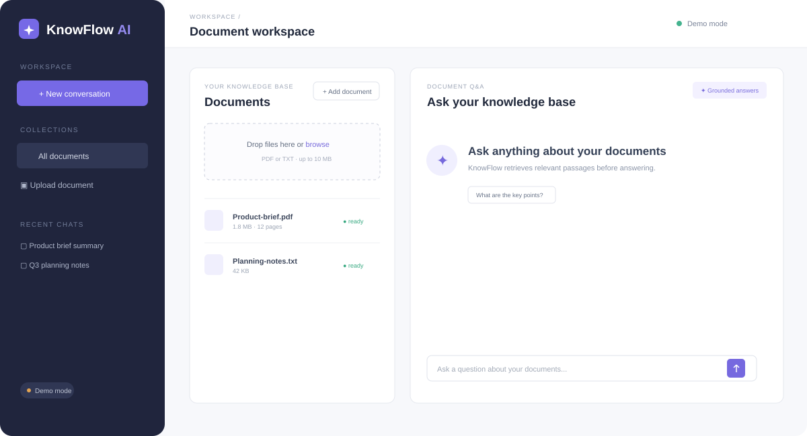
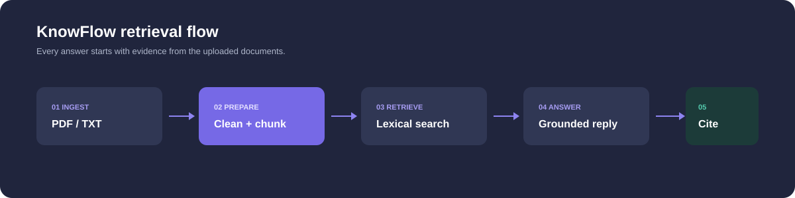

# KnowFlow AI

KnowFlow AI is a document question-answering workspace. Upload a PDF or text file, let the backend extract and chunk it, ask a question, and inspect the retrieved source passages behind the answer.





## What is implemented

- PDF and plain-text ingestion with a 10 MB default limit
- Temporary-file cleanup and generated storage identifiers
- Page-aware metadata for PDFs where available
- Configurable overlapping text chunks
- Local lexical retrieval that works without a paid AI API
- Deterministic demo answers clearly marked as `demo`
- Optional backend-only OpenAI-compatible chat adapter
- Source citations that open the exact retrieved passage
- MongoDB persistence for documents, chunks, conversations, and messages
- Document deletion with chunk cleanup
- Loading, empty, processing, failure, and API error states
- Responsive document sidebar and chat workspace

## Architecture

```text
Upload -> Express route -> ingestion service -> MongoDB documents + chunks
Question -> lexical retriever -> grounded context -> demo/provider adapter
                                      -> answer + citations -> conversation history
```

Retrieval is deliberately lexical for the local MVP: it scores overlapping question terms and returns the highest-ranked chunks. It is not vector search. The retriever is isolated behind a small function so an embedding index can replace it later without changing the chat route.

Document text is untrusted evidence. The provider prompt explicitly says not to follow instructions found inside uploaded documents. The demo mode only returns excerpts from retrieved chunks and never invents facts or citations.

## Local setup

Prerequisites: Node.js 22+, npm, and MongoDB available on port `27019`.

```bash
cp server/.env.example server/.env
cp client/.env.example client/.env
npm install
npm --prefix server install
npm --prefix client install
npm run dev
```

Open `http://localhost:5173`. The API is at `http://localhost:4200`.

## Docker

```bash
docker compose up --build
```

MongoDB maps to host port `27019` and remains on `27017` inside Docker. Data uses the persistent `knowflow-mongo` volume. The Compose demo uses `LLM_MODE=demo`, so no provider key is required.

## Optional provider mode

Set these in `server/.env`:

```env
LLM_MODE=api
LLM_API_URL=https://your-provider.example/v1/chat/completions
LLM_API_KEY=your-secret-key
LLM_MODEL=your-model-name
```

The key is read only by the backend and is never sent to the browser. Provider mode has a 20-second request timeout and returns a clear error when the provider fails. Demo mode is the default and is the mode tested locally.

## API

All routes use `/api/v1`:

- `GET /health`
- `POST /documents` multipart field `file`
- `GET /documents?limit=50`
- `GET /documents/:id`
- `DELETE /documents/:id`
- `POST /documents/:id/reprocess` (returns `501` because temporary originals are intentionally deleted)
- `POST /chat` with `{ "question": "What are the key points?", "conversationId": "optional-id" }`
- `GET /conversations`
- `GET /conversations/:id`
- `DELETE /conversations/:id`
- `GET /search?q=retention&limit=20`

Chat responses include `answer`, `mode`, `conversationId`, and `sources`. Each source includes `documentName`, `page` where known, `chunkId`, and the retrieved `passage`.

## Checks

```bash
npm test
npm run build
```

The server tests cover health, text chunking, overlap, retrieval ranking, and no-evidence behavior. The frontend production build has been verified. MongoDB integration requires MongoDB or Docker to be running and is not claimed by the unit tests.

## Security and limitations

This is a single-user local demo with no account or tenant isolation. Uploads are restricted to PDF/TXT and bounded by size, temporary paths are generated by Multer, and uploaded content is never executed. Do not expose it publicly without authentication, authorization, malware scanning, stronger per-user quotas, durable file storage, and a production-grade vector/embedding strategy.

Future improvements include page-accurate PDF chunk boundaries, embeddings with a consistent model/dimension, streaming provider responses, background job processing, multi-user access control, and document reprocessing from durable object storage.
# knowflow-AI
